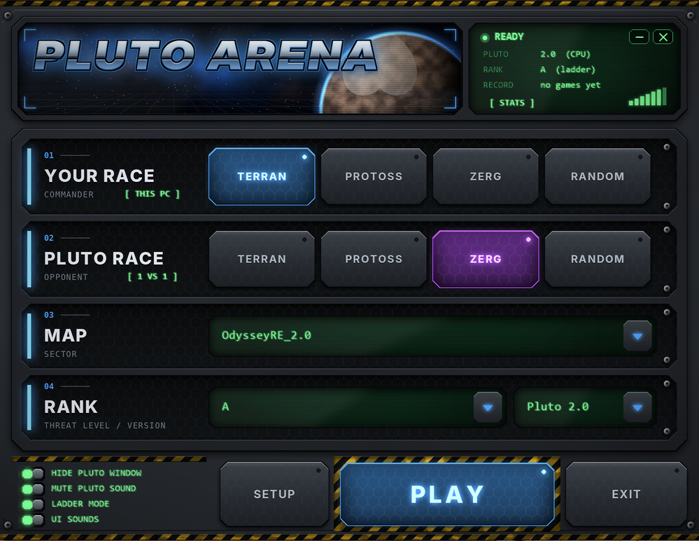
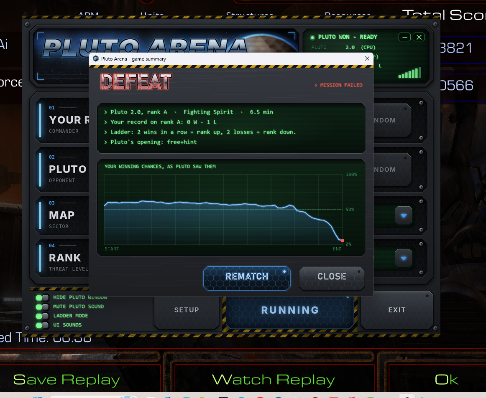
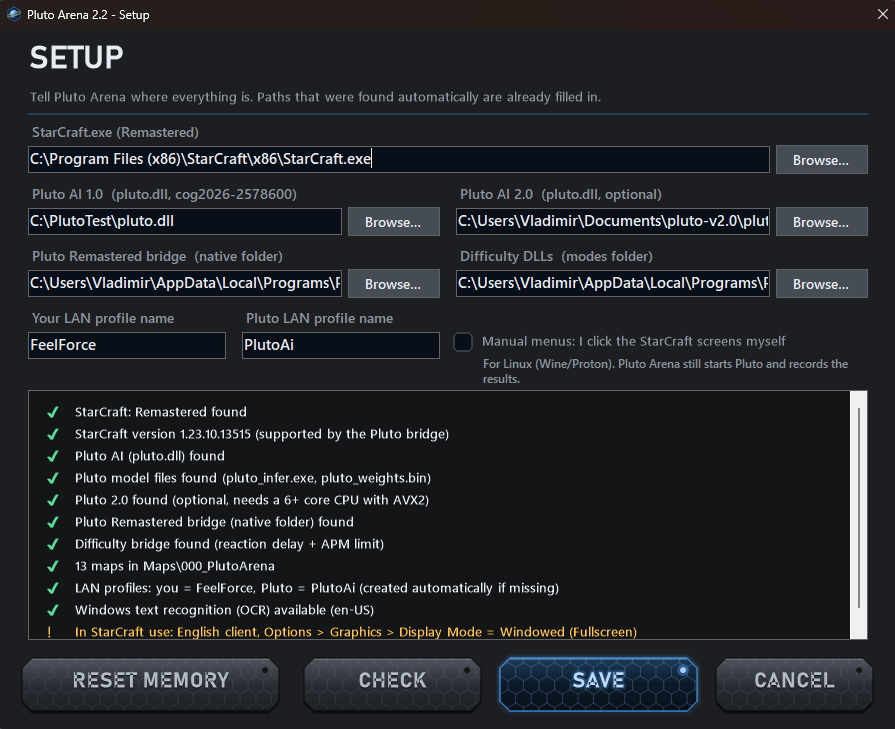

# PlutoArena

### Play against Pluto AI in StarCraft: Remastered

PlutoArena is a Windows launcher that makes it easy to play against
**Pluto AI** (the self-play neural-network bot by [tscmoo](https://github.com/tscmoo/pluto))
in **StarCraft: Remastered**.

Pick your race, Pluto's race, a map and a rank, press **PLAY** - PlutoArena
starts two StarCraft windows (yours and Pluto's), creates a LAN Melee game,
brings Pluto into it and sets the races. You only choose your color and click
**Ok**.

> **Current version: PlutoArena v2.2**

## Download

➡️ **[Download the latest PlutoArena Setup](https://github.com/drvladimirdjapic-maker/PlutoArena/releases/latest)**

All versions: [Releases](https://github.com/drvladimirdjapic-maker/PlutoArena/releases)
(each release lists its VirusTotal scan and SHA-256).

PlutoArena does **not** include StarCraft: Remastered or Pluto AI. Install
StarCraft: Remastered and download a supported Pluto AI release separately
(see [Requirements](#requirements)).

## Features

- **Pluto 1.0 and Pluto 2.0** (2.0 runs on the CPU, no GPU needed) - pick one in the launcher
- **Difficulty ranks S to F**, like the ladder: S = full strength; S-B only
  add reaction delay, from C down also an APM limit
- **REMATCH** - play again without restarting StarCraft
- **Ladder mode** - 2 wins in a row = rank up, 2 losses = rank down
- **Game summary** after each game, with Pluto 2.0's own win-probability chart
- **STATS** - your results by Pluto's race, your race and map
- **Game history with replays** - every game is listed with a link to its replay
  (also in StarCraft under Watch Replay > PlutoArena)
- Remembers your races and the last map; tells you when a new version is out
- **Play from another PC** - host the LAN game on any computer (also Linux/Mac with StarCraft), Pluto Arena on a Windows PC or VM runs only Pluto and joins your game
- **Team mode** (experimental) - Pluto alone against several players, e.g. 2 vs Pluto; Pluto can also have allies (e.g. two Plutos in Top vs Bottom)
- **Manual mode** - Pluto Arena starts Pluto, you click through the StarCraft menus yourself (first step towards Linux, see below)
- Pluto's chat ("gl hf", "gg") shown on your screen, Pluto's sound muted
- Command-console look that takes the color of your race, UI sounds
- Race and map selection, arena maps included
- Native SC:R bridge included - no extra downloads besides Pluto itself

---

## Demo

Watch PlutoArena running with StarCraft: Remastered (v1.2):

https://youtu.be/kwpX3nmxXg0

---

## Screenshots

### Main Interface

Choose your race, Pluto's race, map, rank and Pluto version from a single
console. The window takes the color of your race.



### Game Summary

After each game: the result, your record on the rank and - with Pluto 2.0 -
your winning chances as Pluto saw them during the game.



### Setup & Compatibility Check

The Setup screen checks the StarCraft: Remastered version, Pluto AI files,
the bridge, difficulty modules, maps, LAN profiles and OCR support.



---

## Requirements

1. **StarCraft: Remastered 1.23.10.13515**, English client,
   *Options > Graphics > Display Mode = Windowed (Fullscreen)*
2. **Pluto AI by tscmoo** - not included (binary-only release, no redistribution license):
   - Pluto 1.0: [release cog2026-2578600](https://github.com/tscmoo/pluto/releases/tag/cog2026-2578600)
   - Pluto 2.0 (optional, CPU with AVX2, 6+ cores): [release v2.0](https://github.com/tscmoo/pluto/releases/tag/v2.0)
3. **Windows 10/11 64-bit on an x86/x64 PC** (PlutoArena uses the English Windows OCR; it tells you if it is missing).
   ARM laptops (e.g. Snapdragon) are not supported: StarCraft and Pluto run there only in emulation and crash.
4. **A CPU with AVX2** (Pluto's engine needs it; SETUP checks it). In a virtual machine set the CPU type
   to *host* (Proxmox/QEMU), otherwise Pluto crashes at the start with 0xC000001D and does nothing.

### Linux / Mac

- **Works today:** play from Linux/Mac against Pluto running on a Windows PC in the same network
  (*Other PC* mode).
- **Experimental, not tested yet:** everything on one Linux PC with Wine/Proton. Windows text recognition
  does not exist there, so Pluto Arena switches to manual mode (you click the menus, Pluto Arena starts Pluto
  and records the result). Reports are welcome in [Issues](https://github.com/drvladimirdjapic-maker/PlutoArena/issues).

> **Important:** The native bridge required by PlutoArena is included with
> PlutoArena. You do not need to download it separately.

---

## Installation

1. Run `PlutoArena-<version>-Setup.exe` (no administrator rights needed).
2. Start PlutoArena - on the first start the **SETUP** window opens.
3. Check the paths (most are found automatically) and click **CHECK**
   (green = OK, yellow = warning, red = must be fixed), then **SAVE**.

## How to Play

1. Close all StarCraft windows.
2. Choose your race, Pluto's race, the map, the rank and the Pluto version.
3. Press **PLAY** and wait (~45 s) - the mouse and keyboard are locked
   while PlutoArena clicks through the menus (**Esc** cancels).
4. In the lobby choose your color and click **Ok**.
5. After the game: **REMATCH** or **CLOSE**.

---

## Difficulty Ranks

| Rank | Reaction delay | APM limit |
|---|---|---|
| S | none (original Pluto) | none |
| A | 0.08 s | none |
| B | 0.17 s | none |
| C | 0.25 s | 220 |
| D | 0.40 s | 170 |
| E | 0.60 s | 130 |
| F | 0.80 s | 100 (beginner) |

S to B differ only in reaction time, so Pluto plays "like itself", just
slower to react. From C down the APM limit also cuts its bursts in fights.

---

## What the program does on your PC

PlutoArena automates things that look unusual for a normal app, so here is
exactly what it does and where in the code:

| What | Why | Code |
|---|---|---|
| Starts StarCraft twice | One window for you, one for Pluto. StarCraft allows only one instance, so the launcher closes the "Starcraft Check For Other Instances" handle in the first process. | `ScrMultiInstance.cs` |
| Loads the Pluto Remastered bridge into Pluto's StarCraft | The bridge (by lpflhh, see below) runs Pluto inside StarCraft: Remastered. Pluto Arena checks the file hashes (StarCraft, Pluto release), starts Pluto's StarCraft and loads the bridge with the bridge's own `scr-loader.exe` - only into Pluto's StarCraft, never into yours. Same steps as the bridge's `start-pluto.ps1`. | `PlutoStarter.cs` |
| Runs PowerShell (only if enabled) | With `PowerShellStart=1` in `PlutoArena.ini`, the bridge's `native\scripts\start-pluto.ps1` is used instead (as in versions before 2.2). | `ArenaLauncher.StartPlutoBridgePowerShell` |
| Reads the screen (Windows OCR) | To see which StarCraft menu is shown (Multiplayer, LAN, Create Game, score screen ...). Nothing is saved unless you turn on `DebugImages=1`. | `ScrOcr.cs` |
| Clicks and presses keys | To click through the StarCraft menus (SendInput). | `ScrInput.cs` |
| Blocks the real mouse/keyboard for ~45 s | While it clicks through the menus, so a bumped mouse cannot break it. **Esc** cancels at once; it unlocks by itself after 3 minutes at most. Low-level hooks, no keys are recorded. | `InputBlocker.cs` |
| Mutes Pluto's StarCraft | Windows volume mixer (Core Audio) for Pluto's process only. | `ScrAudio.cs` |
| Copies replays | After a game, StarCraft's own replay (`Replays\AutoSave`) is copied to `Documents\StarCraft\Maps\Replays\PlutoArena`. | `ArenaStats.cs` (`Replays`) |
| One request to GitHub at start | Asks `api.github.com` for the latest PlutoArena release to show "NEW x.y". Nothing is downloaded or installed; `CheckUpdates=0` in `PlutoArena.ini` turns it off. | `ArenaExtras.cs` (`Updater`) |

Apart from that update check, PlutoArena makes no network connections (the
LAN game is StarCraft's own). Settings, log and statistics are plain text
files next to the exe: `PlutoArena.ini`, `PlutoArena.log`, `PlutoArena-stats.txt`.

---

## Building from source

### 1. PlutoArena (C#)

- [.NET 8 SDK](https://dotnet.microsoft.com/download/dotnet/8.0)

```powershell
dotnet build
.\bin\Debug\net8.0-windows10.0.19041.0\PlutoArena.exe
```

### 2. The Pluto Remastered bridge (C++) - optional

The bridge is [lpflhh/Pluto-AI-Starcraft-Remaster](https://github.com/lpflhh/Pluto-AI-Starcraft-Remaster).
PlutoArena's changes are in `bridge-patch/` (see its README):

- reaction delay + APM limit (difficulty ranks), read per game from `bridge.ini`
- Pluto v2.0 support (binding table for the v2.0 `pluto.dll`)
- LAN games: commands are sent in the same frame, so Pluto acts after the
  4 frames it was trained for
- team mode: Pluto stays while opponents are left, retargets, may have allies
  (allied units hidden from Pluto, allied Plutos share one target)

Needs Visual Studio 2022 (or Build Tools) with "Desktop development with C++".

### 3. Installer

- [Inno Setup 6](https://jrsoftware.org/isdl.php)

```powershell
powershell -ExecutionPolicy Bypass -File .\installer\publish.ps1
```

Output: `installer\output\PlutoArena-<version>-Setup.exe`. The script expects
the bridge's `native` folder, the difficulty DLLs and the maps in the default
folders (see the parameters at the top of `publish.ps1`).

### Project layout

| File | Purpose |
|---|---|
| `Form1.cs` | Main window: layout, status screen, start-up animation |
| `ArenaTheme.cs` | Custom-drawn controls (sprites in the main window, drawn in code in the dialogs) |
| `ArenaSkin.cs` | Loads the embedded skin (backgrounds, button sprites) and plays the UI sounds |
| `StatsForm.cs` | STATS window: results by Pluto's race, your race and map |
| `ArenaLauncher.cs` | PLAY: starts Pluto and StarCraft, clicks through the menus, supervises the game, rematch, team mode, other-PC mode |
| `PlutoStarter.cs` | Starts Pluto's StarCraft and loads the bridge (hash checks, bridge.ini, scr-loader) |
| `ArenaMenuText.cs` | Text-only menu decisions (LAN games list, profiles), tested in `tests/MenuRegression` |
| `ArenaSetup.cs` | SETUP window and the checks (StarCraft version, Pluto files, bridge, OCR) |
| `ArenaConfig.cs` | `PlutoArena.ini` |
| `ArenaPlatform.cs` | Windows or Wine; screen reading on/off (manual mode) |
| `ArenaStats.cs` | Your record, ladder mode, Pluto's per-opponent memory and 2.0 game log |
| `ArenaExtras.cs` | Version/icon, Pluto chat pop-up, game summary window |
| `ScrOcr.cs` | Screen reading (Windows OCR) with fallbacks for bright menu backgrounds |
| `ScrInput.cs` | Window handling, clicks, keys, screen capture |
| `ScrMultiInstance.cs` | Second StarCraft instance |
| `InputBlocker.cs` | Temporary mouse/keyboard lock (Esc cancels) |
| `ScrAudio.cs` | Mutes Pluto's StarCraft |
| `Skin/` | Window backgrounds, button sprites and UI sounds (embedded in the exe) |
| `tools/make_skin.py`, `tools/skin_art.py` | Generate everything in `Skin/` (Python + Pillow + numpy) - original art, no game files |
| `tools/make_icon.py` | Generates `pluto-arena.ico` (Python + Pillow) |
| `installer/` | Inno Setup script, `publish.ps1`, the README shipped with the installer |
| `bridge-patch/` | Changes to the Pluto Remastered bridge |

---

## Known Issues

PlutoArena is a community project and is still under development.
Compatibility may depend on:

- StarCraft: Remastered version (the bridge checks the exact version; a new
  Blizzard patch needs an updated bridge)
- Pluto AI version (only the two releases above pass the bridge's file check)
- Windows configuration (English OCR must be installed)
- ARM (Snapdragon) laptops are not supported

If you encounter a problem, please report it through
[GitHub Issues](https://github.com/drvladimirdjapic-maker/PlutoArena/issues)
and attach `PlutoArena.log` (next to `PlutoArena.exe`).

---

## Credits and licenses

- **PlutoArena**: MIT license, see `LICENSE`.
- **Pluto AI** by tscmoo - <https://github.com/tscmoo/pluto> (not included).
  PlutoArena is not the Pluto AI project and does not claim authorship of it.
- **Pluto Remastered bridge** by lpflhh - <https://github.com/lpflhh/Pluto-AI-Starcraft-Remaster>.
  The bridge contains BWAPI (LGPL v3) and MinHook (BSD). PlutoArena's changes
  to it are in `bridge-patch/`.
- The skin and sounds are generated by `tools/make_skin.py`; the logo is
  rendered with the Inter font (SIL Open Font License).

## Disclaimer

PlutoArena is an independent, unofficial community project. It is not
affiliated with, sponsored by, approved by, or endorsed by Blizzard
Entertainment or the Pluto AI developers.

StarCraft and StarCraft: Remastered are trademarks of Blizzard Entertainment,
Inc. PlutoArena contains no StarCraft or Blizzard files.

---

## Development

PlutoArena is under active development. Feedback, bug reports,
compatibility reports and testing results are welcome.
